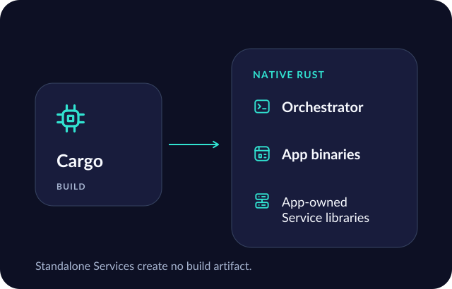

# l build reference

## Command syntax

```text
l build [--language LANGUAGE] [--assets ROOT] [--output-dir DIRECTORY] [main.l]
```

Only `build` is a command. Options follow `build` and precede the source filename. With no source argument, `main.l` is resolved relative to the invocation directory. Exactly one positional filename is accepted. `--` ends option parsing, including for a filename beginning with a dash.

```sh
l build
l build --language eng --output-dir './output directory' './source directory/main.l'
l build -- -example.l
```

The Go FlagSet accepts both single- and double-hyphen spellings and either a separate value or `=value`. Prefer the documented double-hyphen forms. An explicitly empty flag value is rejected. Whitespace-only or unavailable language identifiers fail compiler initialization. Repeating a value option follows FlagSet's last-value behavior; this is parser behavior, not a distinct language feature.

## Options

| Option | Default | Meaning |
| --- | --- | --- |
| `--language LANGUAGE` | `eng` | Select the source lexicon and matching source resources. Only English is bundled. |
| `--assets ROOT` | Embedded resources | Select one complete filesystem containing `lexicon`, `builtins`, and `stdlib`. |
| `--output-dir DIRECTORY` | Source directory | Put the published executable and companion directory together here. |
| `--` | None | Stop flag parsing before the optional filename. |

Relative source, asset and output paths use caller CWD. Resolution does not change CWD. An explicit asset provider has no embedded fallback and no compiler configuration JSON. Bare dictionary imports use that provider's standard-library index; explicit `.l` imports remain relative to the importing source's provider.

## Legacy OS option

The legacy `-os`/`--os` flag is registered solely to produce an unsupported-option diagnostic. The stored historical parser field `ubuntu` does not choose a target. The host operating system and architecture determine the native build.

## Help

`l --help`, `l -h`, and `l -help` show build help when supplied as the sole top-level argument. `l build --help`, `l build -h`, and `l build -help` request command help before a filename. Help returns 0 and writes to stdout unless that write fails. A help flag after a filename is another positional argument and does not bypass ordering rules.

The precise usage text is source-derived from `buildUsage` in [command.go](../../cmd/l/command.go); it is not a runtime capture in this pass. Examples such as `l run main.l` and `l --version` are errors, not undocumented conveniences.

## Published files



For `main.l`, successful publication yields:

```text
main
main.apps/
  .l-owner
  generations/
    <generation-id>/
      manifest.json
      app-000
```

The companion inventory contains the program's App binaries. App-constructed Service libraries remain build dependencies and add no executable companions; standalone Service declarations add no packages. Publication uses version-1 manifests with the `apps` inventory.

Every build stages privately, compiles all required workspace members, validates Cargo's artifact identities, publishes the complete immutable companion generation, then atomically replaces the adjacent orchestrator. Failed builds preserve a previously working output. Old generations remain for already-running orchestrators. The compiler rejects unrelated output files and symlinked companion/generation directories instead of overwriting them.

The executable finds its own companion generation relative to its executable location. Move it and its `.apps` directory together. The source filename stem remains the public output basename even when internal Cargo names need collision avoidance. See the maintained [publication contract](../cli-build.md#output-and-publication) for failure and concurrent-build details.

## Streams and statuses

| Status | Boundary |
| --- | --- |
| 0 | Help or a successful native build. |
| 2 | Invalid invocation or unsupported host. |
| 1 | Resolution, asset initialization, compilation, generation, Cargo, publication, or output-write failure. |

Successful build stdout contains only the absolute published executable path and a newline. Compiler diagnostics go to stderr. Building does not run source instructions, Apps or generated deployment scripts. Application exit status and stdout belong to the separately invoked program.

## Verification witnesses

[Command tests](../../cmd/l/command_test.go) cover help, defaults, option order, empty options, unsupported commands and resource diagnostics. [Publication tests](../../cmd/l/build_publish_test.go) cover preserved prior outputs, matched concurrent generations and unrelated destinations. [Cargo identity tests](../../cmd/l/cargo_identity_integration_test.go) inspect genuine native artifact identity. They are existing witnesses, not tests run by this website pass.
